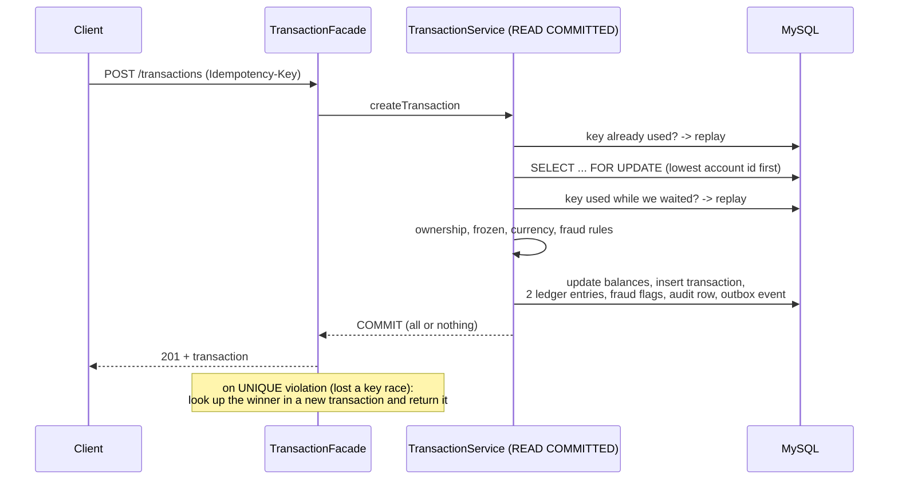
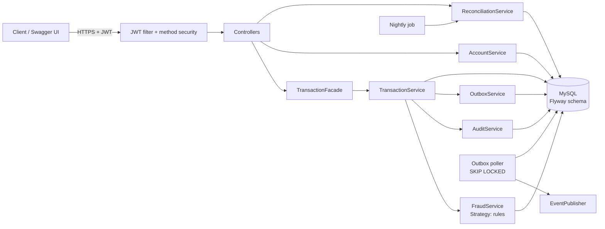
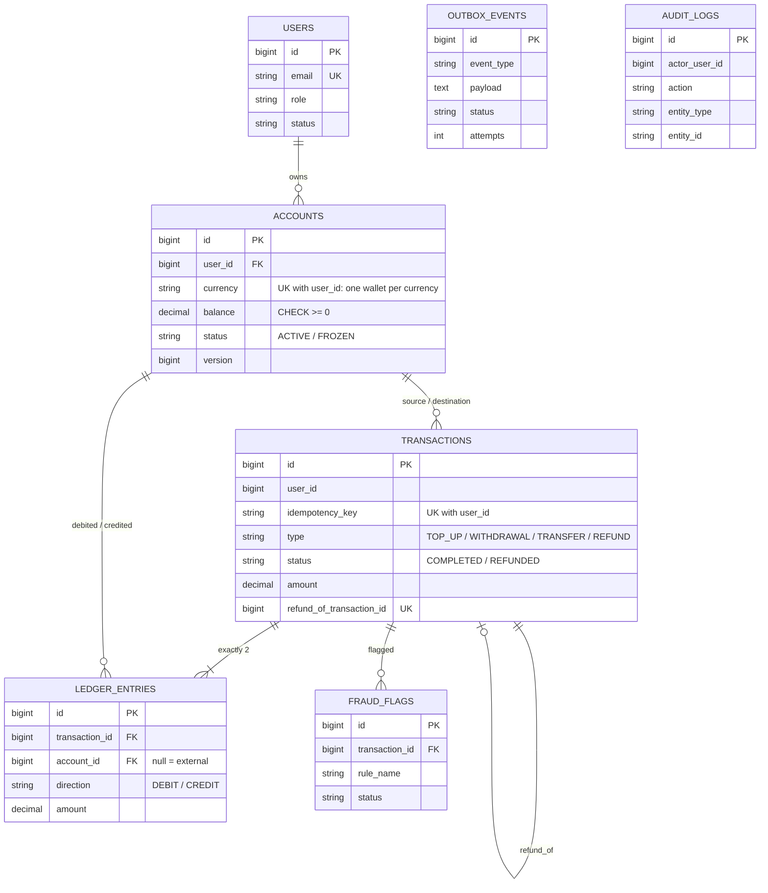

# PayLedger: Full-Stack Financial Ledger Platform

**React frontend + Java/Spring Boot backend + MySQL.** A wallet and payments platform built around an **append-only double-entry ledger**. Users top up, withdraw, pay each other and refund payments, and the system stays correct under concurrent load: no overdrafts, no deadlocks, no double spending on retries, and every balance can be proven against the ledger.

**Live app:** https://payledger-ananya.vercel.app · **Live API (Swagger UI):** https://80-225-247-125.sslip.io/swagger-ui/index.html

| Layer | Tech | Where |
|---|---|---|
| Frontend | React 19, React Router, Vite, hand-written CSS effects | [`frontend/`](frontend/) |
| Backend | Java 21, Spring Boot 4, Spring Security (JWT), Spring Data JPA | [`src/`](src/) |
| Database | MySQL 8, Flyway migrations (constraints + triggers) | [`src/main/resources/db/migration`](src/main/resources/db/migration) |
| Ops | Docker Compose, GitHub Actions, Vercel (frontend), Oracle Cloud ARM VM + Caddy HTTPS (API + MySQL) | `Dockerfile`, `.github/`, `frontend/vercel.json` |

## Highlights

- **Double-entry ledger**: every money movement writes a debit and a credit that sum to zero. Ledger and audit tables are append-only, enforced by **MySQL triggers**, not just application code.
- **Idempotency keys**: a retried request returns the original result and never moves money twice, even when 20 identical requests race (`UNIQUE` constraint, post-lock re-check, replay on conflict).
- **Pessimistic row locking with one global lock order**: 1,000 opposing transfers on 32 threads, 0 deadlocks, exact balances.
- **Isolation-level aware**: money movement runs at READ COMMITTED so the daily-limit check cannot be bypassed by parallel requests (see [DECISIONS.md](DECISIONS.md#4-read-committed-for-money-movement-repeatable-read-for-reconciliation)).
- **Transactional outbox** with a `SKIP LOCKED` poller, exponential backoff and a dead-letter state.
- **Reconciliation** (nightly and on demand) that proves every balance equals its ledger total.
- **Fraud rules (Strategy pattern)**: daily limit (blocks), rapid transfers and large amounts (flag for admin review).
- **One wallet per user per currency**, enforced by `UNIQUE(user_id, currency)`, even under parallel requests.
- **Admin tools**: review fraud flags, freeze wallets, disable users (tokens stop working at once), audit trail.
- **Flyway** migrations with CHECK constraints and foreign keys; Hibernate only validates.
- **40 tests** against a real MySQL: unit (Mockito), integration, concurrency and full HTTP flows. CI on GitHub Actions.

## Try it in 2 minutes

1. Open the Swagger UI link above.
2. `POST /api/users`: register (name, email, password of 8+ characters).
3. `POST /api/auth/login`: copy the `token` from the response.
4. Click **Authorize**, paste the token (without "Bearer").
5. `POST /api/users/{userId}/accounts`: open your INR wallet, e.g. `{"currency":"INR","initialBalance":500}`. Each user has **one wallet per currency**, so register a second user to have someone to pay.
6. `POST /api/users/{userId}/transactions` with header `Idempotency-Key: any-unique-string`:
   `{"type":"TRANSFER","sourceAccountId":1,"destinationAccountId":2,"amount":25}` (the destination is the other user's wallet).
7. Send the same request again with the same key: same transaction back, money moved once.
8. `GET /api/users/{userId}/accounts/{accountId}`: the balance plus the balance recomputed from the ledger.

## Frontend (React)

A dark fintech UI on top of the same API, with no backend changes. Its dev server and hosting proxy `/api`, so the browser never makes a cross-origin call.

- **Landing:** a live ledger card that posts sample transactions entry by entry, count-up stats from the real test results, and the 8 steps of a payment.
- **Overview and wallets:** wallet cards coloured per currency, one wallet per currency, a ledger statement and a live **"balance matches ledger"** check per wallet.
- **Move money:** top-up, withdraw and P2P transfer. The browser generates the **Idempotency-Key**, shows it, reuses it on retry, and a **Replay** button proves the same request returns the same transaction.
- **History:** filters, sorting, paging, and refunds of transfers you received.
- **Admin console:** reconciliation with a scanning animation, outbox stats, fraud-flag review, freeze/unfreeze wallets, disable users, the audit log.

```bash
cd frontend
npm install
npm run dev        # http://localhost:5173, proxies /api to the live API by default
```

Details, deployment (Vercel/Netlify) and design notes: [frontend/README.md](frontend/README.md).

## API

| Method | Path | Auth | Purpose |
|---|---|---|---|
| POST | `/api/users` | Public | Register |
| POST | `/api/auth/login` | Public | Log in, receive a JWT |
| GET | `/api/users/{id}` | Owner or admin | Get a user |
| GET | `/api/users` | Admin | List users (paged) |
| POST | `/api/users/{userId}/accounts` | Owner | Open a wallet: **one per currency** (any ISO code, default INR); a duplicate returns 409 |
| GET | `/api/users/{userId}/accounts` | Owner | List wallets |
| GET | `/api/users/{userId}/accounts/{accountId}` | Owner | Wallet + balance recomputed from the ledger |
| GET | `/api/users/{userId}/accounts/{accountId}/statement` | Owner | Ledger entries (paged) |
| POST | `/api/users/{userId}/transactions` | Owner | `TOP_UP`, `WITHDRAWAL` or `TRANSFER` (needs `Idempotency-Key`) |
| POST | `/api/users/{userId}/transactions/{id}/refund` | Receiver | Refund a transfer you received (needs `Idempotency-Key`) |
| GET | `/api/users/{userId}/transactions` | Owner | History: filter by `accountId`, `type`, `status`, `from`, `to`, `minAmount`, `maxAmount`; paged, sortable |
| GET | `/api/users/{userId}/transactions/{id}` | Sender or receiver | One transaction |
| POST | `/api/admin/reconciliation/run` | Admin | Verify every balance against the ledger |
| GET | `/api/admin/fraud-flags` | Admin | Flagged transactions |
| POST | `/api/admin/fraud-flags/{id}/review` | Admin | Mark `CLEARED` or `CONFIRMED` |
| POST | `/api/admin/accounts/{id}/freeze` / `unfreeze` | Admin | Stop a wallet sending and receiving |
| POST | `/api/admin/users/{id}/disable` / `enable` | Admin | Lock a user out immediately |
| GET | `/api/admin/audit-logs` | Admin | Audit trail, filterable |
| GET | `/api/admin/outbox/stats` | Admin | Pending, published and failed events |
| GET | `/actuator/health` | Public | Health check (includes the database) |

Errors always have the same shape: `{timestamp, status, error, message, path, errors?}`, with 400 (validation), 401, 403, 404, 409 (conflict, frozen), 422 (insufficient balance, fraud block, idempotency key reuse) and 503 (lock contention, safe to retry).

## How a transfer works



## Architecture



## Data model



## Proof: tests

All tests run against a real MySQL with real threads released by a latch (`./mvnw test`). Recorded output: [`docs/PASSED_RUN.txt`](docs/PASSED_RUN.txt).

> **Bugs I broke on purpose, and how I fixed them:** [docs/BUGS_AND_FIXES.md](docs/BUGS_AND_FIXES.md). Lost updates without locking (5,000 paid out of a 1,000 balance), deadlocks with optimistic locking (912 of 1,000 transfers failed), and a daily limit bypassed by MySQL's default isolation level (10 of 10 parallel transfers passed a limit that allows 6). Each one has measured before/after numbers.

| Test | What it proves |
|---|---|
| `ConcurrencyTest` | 50 parallel withdrawals of 100 from 1,000: exactly 10 succeed. 20 parallel requests with one key: 1 transaction, all 20 callers get its id, 0 errors. 1,000 opposing transfers: 0 failures, 0 deadlocks, exact balances. 10 parallel "open INR wallet" requests: exactly 1 wallet. |
| `LedgerIntegrityTest` | 300 concurrent random transfers across 3 users: money conserved, every balance equals its ledger, every transaction nets to zero. Raw SQL `UPDATE`/`DELETE` on the ledger and a negative balance are rejected by the database. |
| `FraudIntegrationTest` | 10 parallel 30k transfers against a 200k daily limit: exactly 6 succeed. Blocked attempts are audited despite the rollback. Large transfers are flagged. |
| `RefundAndP2PTest` | Cross-user payments and refunds, 10 concurrent refunds of one transfer → exactly 1, frozen wallets, currency mismatch, key reuse, history filters. |
| `OutboxTest` | Commit → exactly one event; rollback → none; a failing broker → backoff, then `FAILED`. |
| `ReconciliationTest` | A balance corrupted with raw SQL is reported with the exact difference and raises an alert event. |
| `ApiFlowTest` | Over HTTP: 401/403, tampered tokens, idempotent replay, field-level validation errors, admin freeze/disable/audit. |
| `FraudRulesTest` | Each rule and the strategy runner in isolation (Mockito, no database). |

### Pessimistic vs optimistic locking

Same workload under each strategy (`LockingBenchmarkTest`, numbers from my machine):

| Strategy | 50 × withdraw 100 from 1,000 | 1,000 opposing transfers (32 threads) |
|---|---|---|
| No locking (naive read-check-write) | **Broken**: all 50 "succeed" (5,000 paid out) yet the balance only fell to 800 | **Broken**: 157.00 destroyed, 435 deadlock failures |
| Optimistic (`@Version`), no retry | Safe, but only 2 of 10 valid withdrawals served | Safe, but 945 of 1,000 rejected |
| Optimistic + retry | Correct, 342 retries, 841 ms | 969 served, 31 gave up after 200 retries, **23,670 retries**, 17.1 s |
| **Pessimistic (`FOR UPDATE`, ordered)** | Correct, 0 retries, 231 ms | **All 1,000 served, 0 retries, 8.8 s** |
| Full production path (pessimistic + ledger, fraud rules, audit, outbox) | Correct, 1.4 s | All 1,000 served, 29.3 s |

Under heavy contention on the same rows, optimistic locking either rejects most valid requests or burns time retrying; pessimistic locking queues them and serves every one. Optimistic would win on low-contention data. The full path is about 3× slower than bare locking because every transfer also writes two ledger entries, an audit row and an outbox event, and evaluates three fraud rules (here the rapid-transfer rule fires on almost every transfer and adds a flag too). Raw output: [`docs/locking-benchmark.md`](docs/locking-benchmark.md).

Run it yourself: `./mvnw test -Dtest=LockingBenchmarkTest -Dsurefire.excludedGroups=`

## Run locally with Docker

```bash
cp .env.example .env        # set DB_PASSWORD, JWT_SECRET (32+ chars), optionally ADMIN_EMAIL / ADMIN_PASSWORD
docker compose up --build
```

Open http://localhost:8080/swagger-ui/index.html. If `ADMIN_EMAIL` and `ADMIN_PASSWORD` are set, that admin account is created on first start.

Generate a JWT secret with PowerShell:

```powershell
$b = New-Object byte[] 48; [Security.Cryptography.RandomNumberGenerator]::Create().GetBytes($b); [Convert]::ToBase64String($b)
```

## Deployment

| Part | Where | How |
|---|---|---|
| React frontend | Vercel | Root directory `frontend`, redeployed on every push. `vercel.json` forwards `/api/*` to the backend, so the browser stays same-origin (no CORS). |
| Spring Boot API + MySQL | Oracle Cloud Always Free ARM VM (Ubuntu 24.04, 1 OCPU, 6 GB) | The same `docker compose up -d --build` as above. Both containers restart automatically after a crash or reboot, so the outbox poller and the nightly reconciliation run 24/7. |
| HTTPS | Caddy on the VM | `caddy reverse-proxy` terminates TLS with an automatic Let's Encrypt certificate and forwards to port 8080. |

Updating the backend: `git pull && sudo docker compose up -d --build` on the VM. The MySQL volume keeps the data.

## Run without Docker

Requires Java 21 and MySQL 8. Set `SPRING_DATASOURCE_PASSWORD` and `JWT_SECRET`, then:

```bash
./mvnw spring-boot:run
```

The `payledger` database is created if missing, and Flyway builds the schema.

## Run the tests

Tests use a local MySQL database `payledger_test` (created automatically; its schema is rebuilt on every run). Give them your MySQL password either as the environment variable `SPRING_DATASOURCE_PASSWORD`, or in a git-ignored file `test-db.properties` in the project root:

```properties
SPRING_DATASOURCE_PASSWORD=your-local-mysql-password
```

```bash
./mvnw test
```

## Tech stack

React 19, Vite, React Router (frontend) · Java 21, Spring Boot 4, Spring Security, Spring Data JPA (Hibernate 7), MySQL 8, Flyway, JWT (jjwt), springdoc-openapi, JUnit 5, Mockito, AssertJ, Maven, Docker, GitHub Actions, Vercel, Oracle Cloud, Caddy.

## Limitations

- Top-ups and withdrawals simulate the outside world (no real bank or card integration).
- Refunds are full refunds of transfers only.
- The event publisher logs events; a real deployment would plug in Kafka or a notification service.
- Scheduled jobs assume a single instance (the outbox poller is already multi-instance safe; the nightly job would need ShedLock).

Design reasoning and trade-offs: **[DECISIONS.md](DECISIONS.md)**. Bugs found and fixed, with evidence: **[docs/BUGS_AND_FIXES.md](docs/BUGS_AND_FIXES.md)**.
